<div align="center">
  <h1>DepartureBoard</h1>
  <p><b>An open-source split-flap departure board for any TV. One command, one board.</b></p>
  
  <p><sub>The Compact preset (6 × 22) running the built-in demo — <code>http://&lt;host&gt;:8080/?demo</code></sub></p>
</div>

---

The real split-flap boards start above $2,000. Most people who want one want the look, the
clicks and the ritual of a message flipping into place — and a TV on the wall is already paid
for. DepartureBoard gives you that: a browser page that behaves like the board, and a settings
page to put messages on it and schedule them.

## Quick start

```bash
git clone https://github.com/cmldexter/DepartureBoard.git
cd DepartureBoard
docker compose up -d
```

That pulls the published image (`ghcr.io/cmldexter/departureboard`, amd64 and arm64, so a
Raspberry Pi can host it) and serves on port 8080. Then:

- On the TV, open `http://<this machine>:8080` and press the **⛶** button: fullscreen, clicks on,
  screen kept awake. The TV side, device by device, is in [**docs/tv-setup.md**](docs/tv-setup.md).
- On your laptop, open `http://<this machine>:8080/settings`. The token it asks for was printed
  in the server log on first boot. To get it again without reading logs:

  ```bash
  docker compose exec departureboard cat /data/api_token            # the container
  pbcopy < data/api_token                                            # a `uv run` dev server, macOS: straight to the clipboard
  xclip -selection clipboard < data/api_token                        # Linux
  ```

Optional: copy `.env.example` to `.env` to change the port, set your timezone, bring your own
token, **give the board a name** (`DEPARTUREBOARD_HOST=dboard.localhost`; what a name does and
does not do is in the [TV guide](docs/tv-setup.md#giving-the-board-a-name)), or **pin a version**
for a board on a wall (`DEPARTUREBOARD_IMAGE=ghcr.io/cmldexter/departureboard:0.4.0`).
Every image is built by [a public workflow](.github/workflows/release.yml) with a provenance
attestation: `gh attestation verify oci://ghcr.io/cmldexter/departureboard:0.4.0 --owner cmldexter`.

To build from source instead: `docker compose -f compose.yaml -f compose.dev.yaml up --build`,
or `uv sync && uv run fastapi dev app/main.py` for a dev server on port 8000.

## What you get

- **The board** (`/`) — two display presets, **Compact** (6 × 22, for a 42–48" TV) and
  **Large** (8 × 28, for 55–77"), the flip animation and the click, a slider from "instant" to
  the full mechanical pace, mute, four themes, colour chips, emoji and your own pictures as
  flaps, and a fullscreen button that keeps the TV awake.
- **The settings page** (`/settings`) — write messages, preview them, schedule them (a window,
  a daily or weekly repeat), choose the preset, theme, animation and sound, upload pictures.
- **Cast to the TV** — a Cast button on the settings page and the board sends the board to a
  Chromecast or Google TV from Chrome (the board on `https://`, one line in `.env`); Chrome's own
  Cast menu works on any board. The laptop stays on; a stick or a Pi runs the board alone.
- **The API** — everything the settings page does. Swagger at `/docs`.
- **The integrate page** (`/integrate`) — copy-paste `curl` lines pre-filled with your own host
  and token, so your calendar, your home automation or your agent can post to the board tonight.

## The settings page

Everything on the board comes from `/settings`: one page, on a laptop or a phone, signed in with
the token the first boot printed. Six tabs — **Board**, **Messages**, **Pictures**, **Guests**,
**Boards**, **Setup** — and on a wide screen the board as the TV sees it stays pinned on the right
whatever tab you are on, so a slider, a new message or an approval shows its effect without
scrolling.

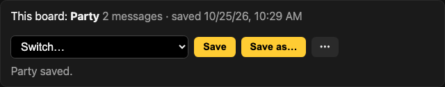

**Boards.** The strip under the header names the board you are looking at — *This board: Party* —
with *Switch…*, *Save*, *Save as…* and a ⋯ menu for Duplicate, Rename and Delete. A board is its
messages and its display settings together: *Save as…* keeps the live one under a name, *Switch…*
puts a saved one on the TV, and a dot after the name says the live board has changed since it was
saved. Each saved board is one JSON file in the data directory — hand-editable, and the export
format — so a party board, a work board and a holiday board are a switch apart, and an agent can
swap them on a schedule. [docs/profiles.md](docs/profiles.md) has the format and what a switch
replaces.

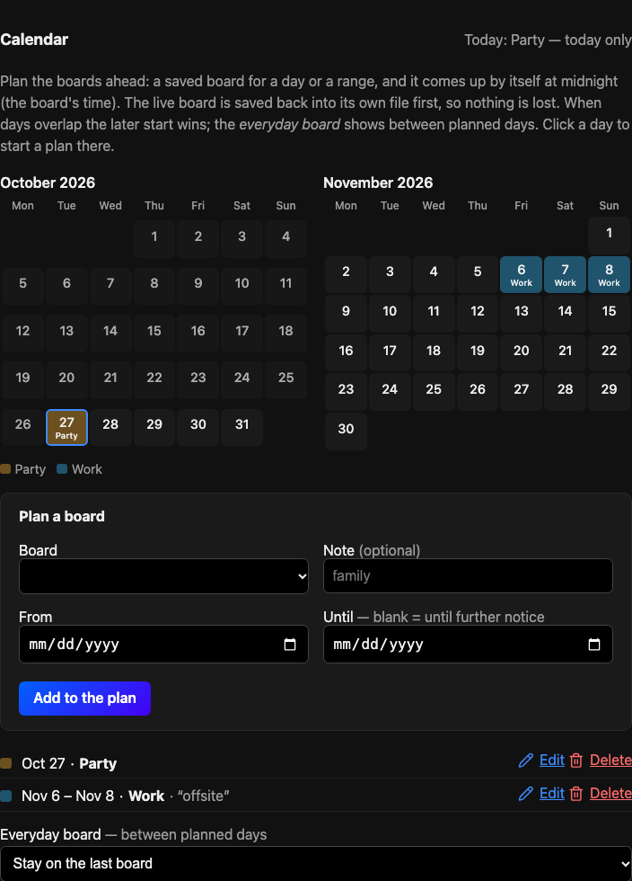

**Calendar.** On the **Boards** tab: plan the boards ahead instead of tending the board every day — pick a saved board
and a day or a range — *Halloween* on the 31st, *Christmas* from the 20th to the 26th — and the
board comes up by itself at midnight, the board's time. The live board is saved back into its own
file first, so edits made on the Halloween board are in the Halloween file the next morning. Two
month grids show the plan tinted by board with today outlined; click a day to start a plan there.
When days overlap the later start wins, and the *everyday board* fills the days between. The plan
is a file beside the saved boards; [docs/calendar.md](docs/calendar.md) has the rules.

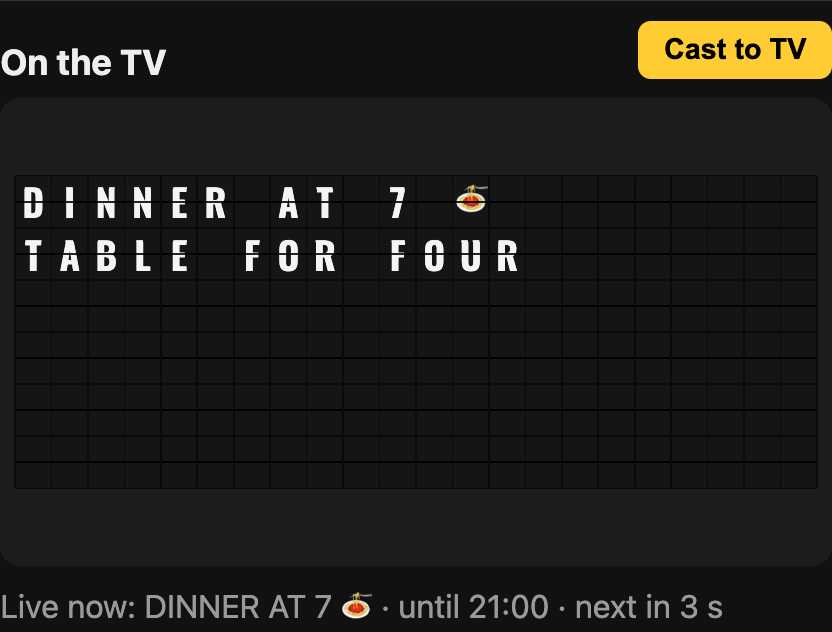

**On the TV.** The live card shows the board as the TV sees it and names the message that is
showing now — at the top of the **Board** tab on a phone, pinned beside every tab on a desktop. **Cast to TV** sends the board to a Chromecast or Google TV from Chrome (with the
board on `https://`; otherwise the button explains the two ways). Casting is new and we have one
TV to try it on: tell us how it holds up for you in [#79](https://github.com/cmldexter/DepartureBoard/issues/79).

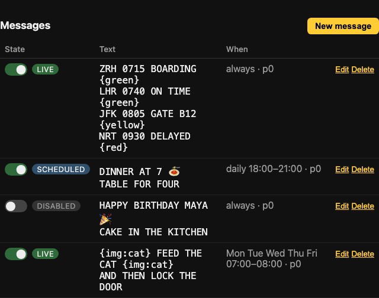

**Messages.** The **Messages** tab: one row each, with a switch that turns the message off and on
without opening it, its state (live, scheduled, expired, disabled), the text, when it shows, Edit
and Delete.

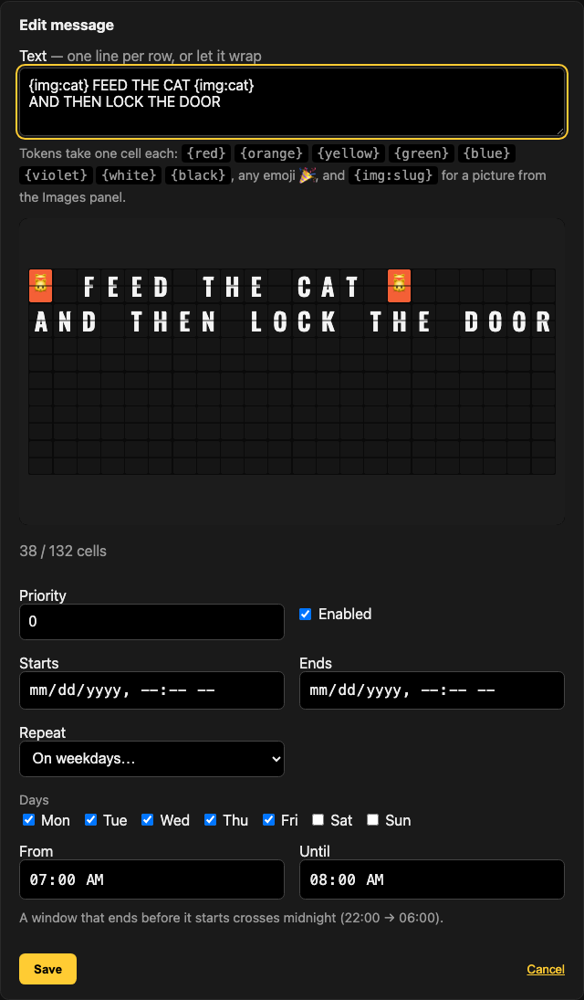

**Writing one.** The preview is the board itself: your theme, the chips, emoji and pictures,
and a line that says how many cells the message uses and what cannot be shown — on a desktop it
sits under the live card on the right while you type. One line per
row, or let it wrap. Three kinds of schedule: a window from one date and time to another, every
day between two times, or chosen weekdays between two times (a window that ends before it starts
crosses midnight). When several messages are live the highest priority wins and equals take
turns, each for the display's *Rotate every* unless the message sets its own *Show for* — a
birthday line can hold the board for a minute while a reminder takes ten seconds. The optional
timer ring, a small translucent countdown in the board's corner, shows how long the current
message has left.

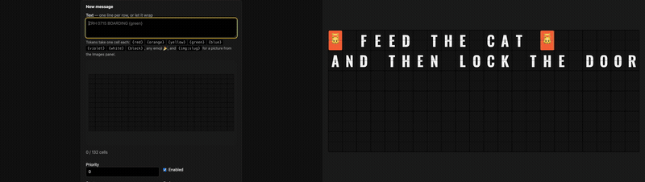

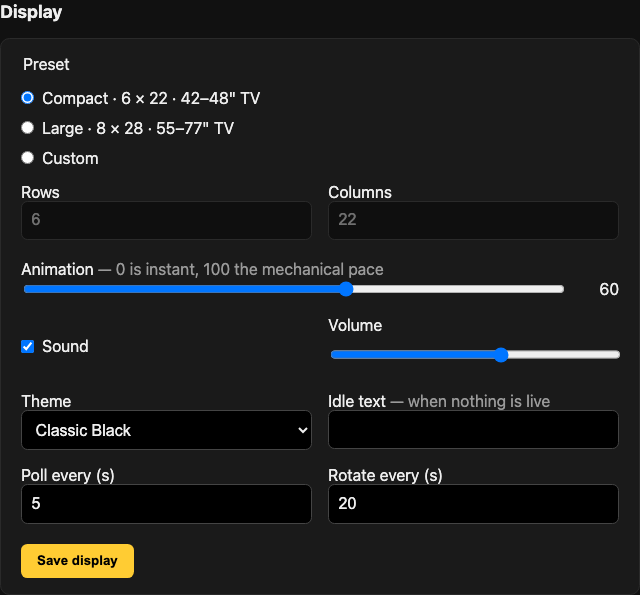

**Look & feel.** On the **Board** tab: four theme swatches; click one and the TV follows on its
next poll, nothing to save. Below them, *Behind the board*: a picture under the frame — one of
the four that ship, or a poster snip uploaded right there — with blur and dim sliders the live
card follows as they move. *Save* sends it to the TV; *Clear* takes it off. Then *The flaps*:
three sliders — corners (0–12 % of a cell), gap (0–1 vmin) and the split line (0–3 px) — and a
*Picture mode* button that tightens all three, so a banner across the board loses less to the
grid; *Classic* puts them back.

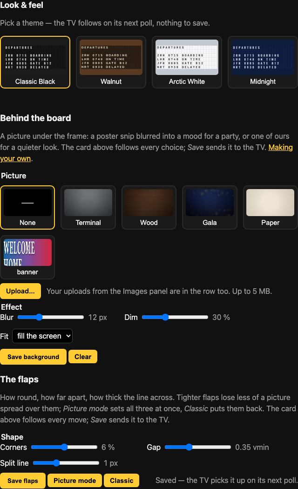

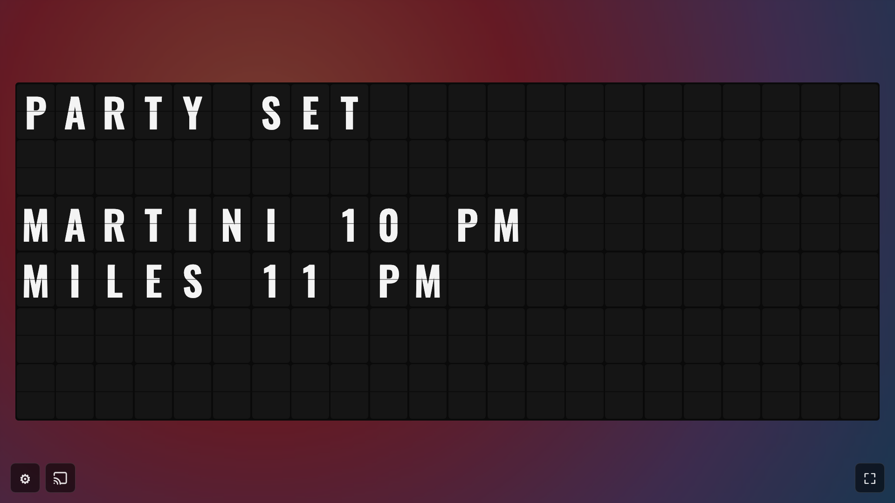

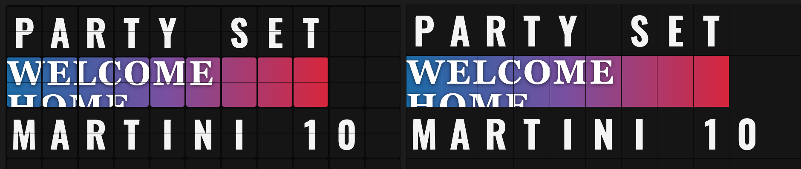

**Display.** Also on the **Board** tab: the preset for your TV size (Compact 6 × 22, Large 8 × 28, or your own), the
animation pace from instant to the mechanical click, sound and volume, the idle text
for when nothing is live, how often the TV polls, the default time each message gets when
several take turns, and whether the timer ring shows (off, only for messages with their own
time, or for every message taking turns).

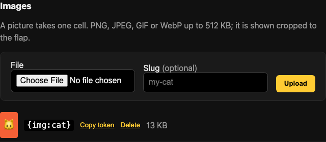

**QR codes.** On the **Pictures** tab, type a link or a line of text and *Make QR*: the server draws the
code as a picture with the same token as any upload, and *Scan to open this board* fills in the
board's own address. A code is *drawn whole* over its block — no gap or split line through it — so
a phone reads it from the sofa: 4 × 3 cells on Compact, 5 × 4 on Large. Any picture can be drawn
whole; a logo keeps its lines that way. [docs/qr.md](docs/qr.md) has sizes against distance, the
contrast rule and three recipes (a menu link, a Wi-Fi string, a guest link).

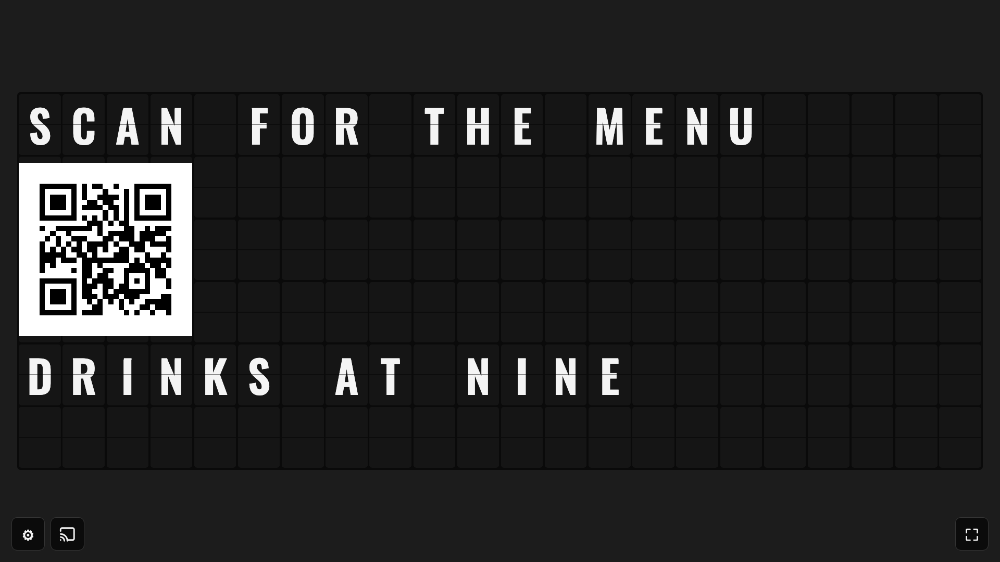

**Pictures.** The **Pictures** tab: upload a PNG, JPEG, GIF or WebP (up to 5 MB) and it becomes a token like `{img:cat}`. Give the
picture a size in cells on the panel — a wide banner reads best across a row — and it keeps its
shape inside that block (or fills it, or stretches, your choice). The panel suggests the sizes
that keep the shape from the file's own pixel size. In a message the picture takes its block,
pushing the lines beneath it down; `{img:cat@9x1}` sizes it for one message only.

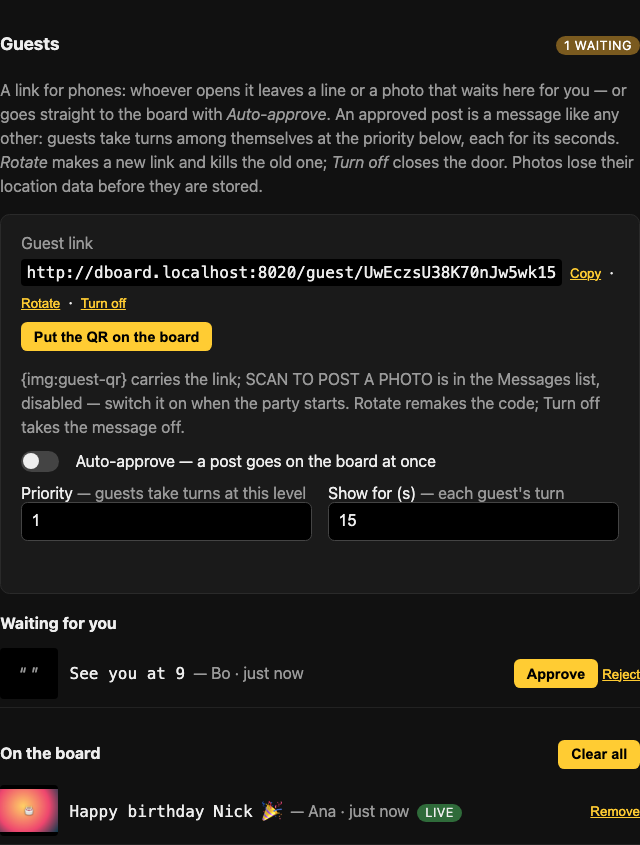

**Guests.** The **Guests** tab: a link for phones, off until you make it. Whoever opens it gets one small page — a
line, a photo, a first name, *Post* — and nothing else: no messages, no settings, and a wrong link
is a plain 404. Posts wait in this section with a thumbnail, the line and the name. *Approve* turns
one into an ordinary message — the words, the photo sized to the rows left, the name last — that
takes turns with the other guests at the priority and for the seconds you set here; *Reject*
throws it away. Switch on *Auto-approve* and a post is on the TV before you look. *Put the QR on
the board* makes a code for the link and a ready-made `SCAN TO POST A PHOTO` message, disabled
until the party starts. Photos lose their location data before they are stored, a phone gets
twenty posts an hour and the board two hundred, *Rotate* kills the link at once and *Clear all*
ends the evening. [docs/guests.md](docs/guests.md) is the whole safety story.

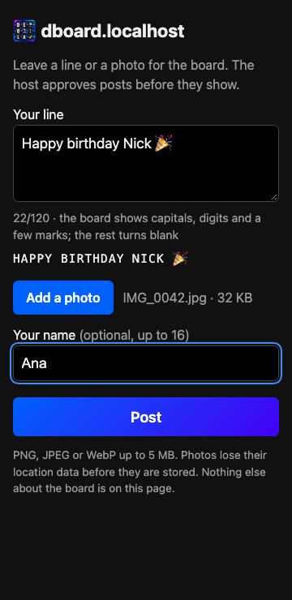

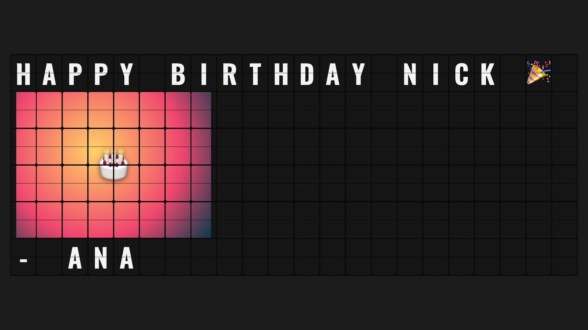

**The token.** On the **Setup** tab with your board's addresses, generated on first boot (or set with
`DEPARTUREBOARD_API_TOKEN`). The TV needs none; the settings page and every write to the API do.

<p>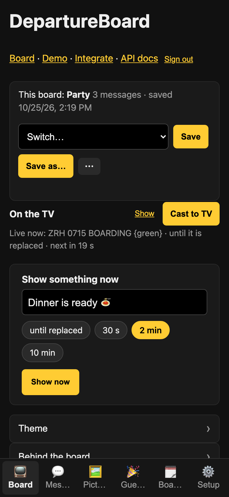 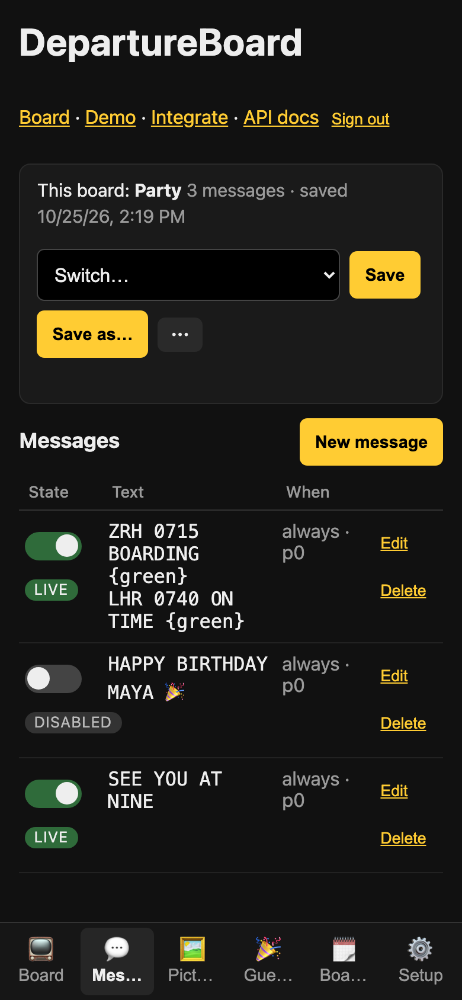</p>

**From your phone.** Under 700 px the page is a remote. The six tabs are a bar along the bottom,
and the **Board** tab opens on *Show something now*: a line, a chip for 30 s, 2 min, 10 min or
until replaced, *Show now*. The board folds to a strip that says what is on and expands on tap.
The main screens stay short: a change (the theme, the display, a message, a picture, a day on the
calendar) takes you to a screen of its own with *Back* at the top, and saving brings you back to
where you were. *Upload a picture* has *Take a photo*, straight from the camera to the board. To
keep it on the home screen like an app:

1. Open `http://<address>:8080/settings` in Safari (iPhone) or Chrome (Android).
2. Safari: **Share** → **Add to Home Screen**. Chrome: **⋮** → **Add to Home screen**.
3. Tap the icon. It opens full-screen, in the board's colours; sign in once and it stays signed in for a year.

For the TV side, read [docs/tv-setup.md](docs/tv-setup.md); to post from a script, a calendar or an
agent, open `/integrate` (pictured below).

## Themes

| | |
|---|---|
| **Classic black** 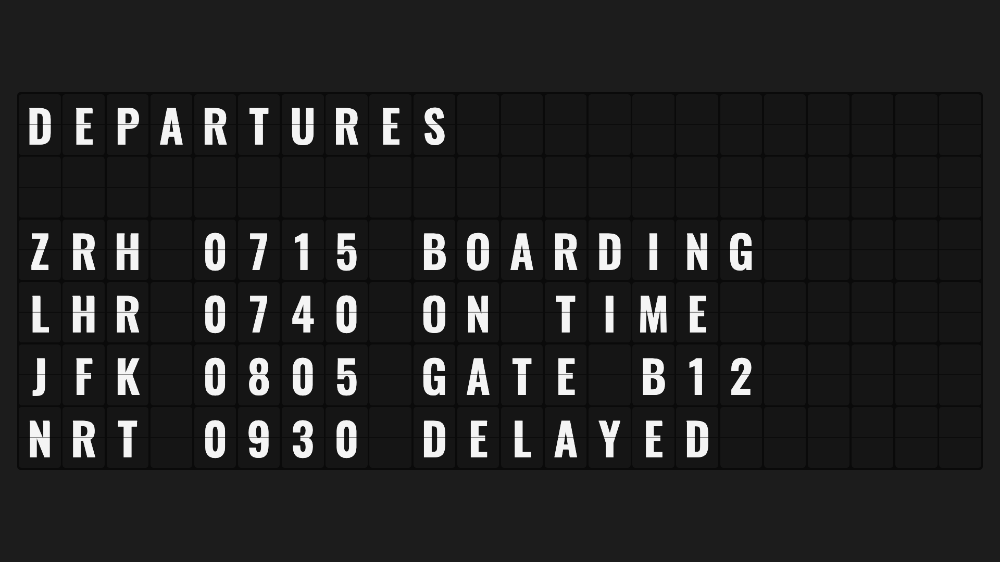 | **Walnut** 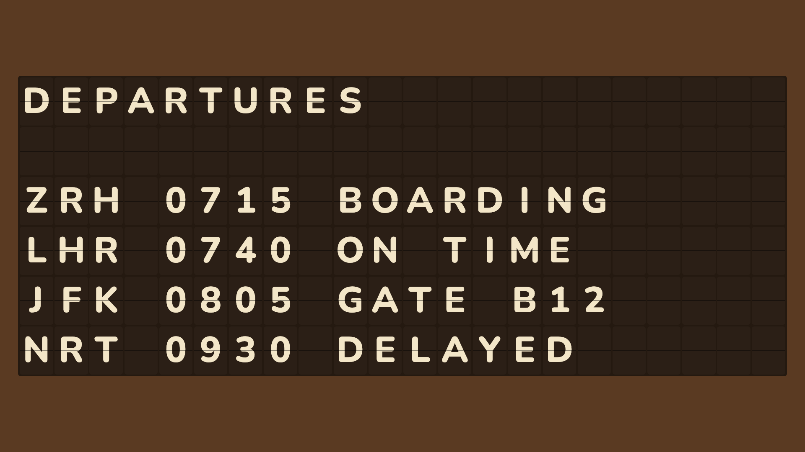 |
| **Arctic white** 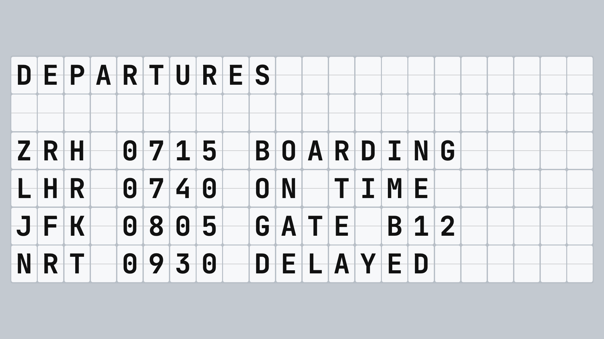 | **Midnight** 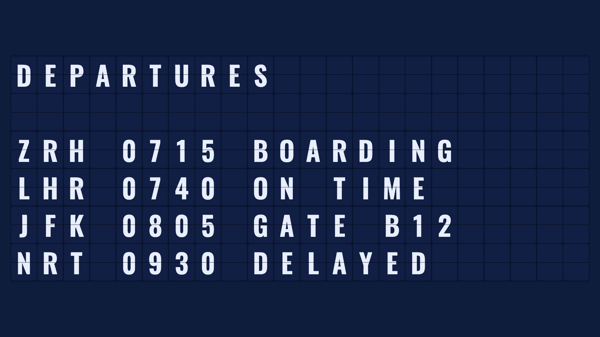 |

Each theme is one stylesheet under `app/static/themes/` with its font bundled, so the board
works on a LAN with no internet. A new theme is a welcome pull request.

Behind any theme can sit a picture: four ship with the app (*terminal*, *wood*, *gala*, *paper*)
and your own uploads work too, blurred and dimmed to taste. [docs/backgrounds.md](docs/backgrounds.md)
has the four-click recipe, the safe area and a 1920 × 1080 template.

## Bring your own integration

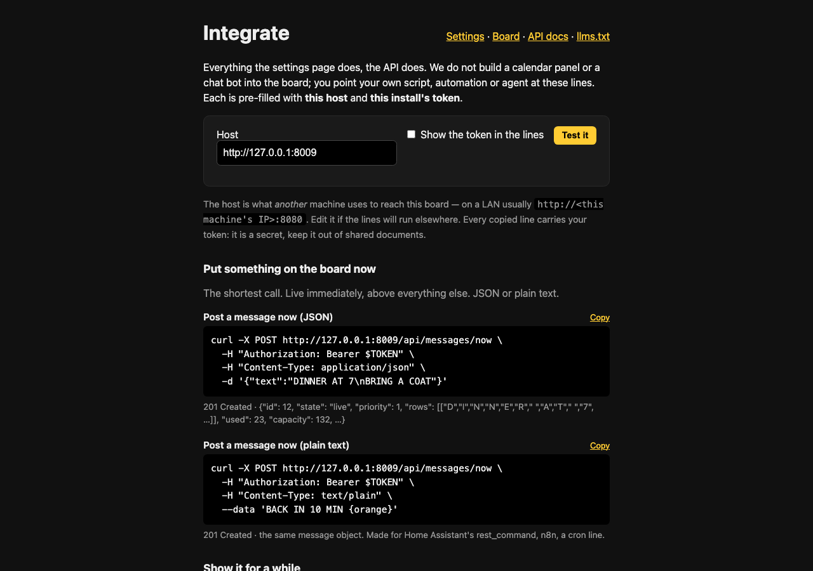

We will not add a calendar panel, a chat bot or a weather widget to the UI. The board has an
API, and we ship three things so that your own agent, script or automation can drive it:

1. **The integrate page** — `http://<this machine>:8080/integrate`, behind the same token as
   settings: copy-paste `curl` lines pre-filled with your host and your token, one per task
   (post now, a window, daily, weekly, a picture, list, delete, the display), with the expected
   response under each. The complete reference is `/docs` (Swagger, generated from the code).
2. **The shortest call** — `POST /api/messages/now` takes a plain-text body, so a cron line,
   Home Assistant's `rest_command` or an n8n node is one line:

   ```bash
   curl -X POST http://<this machine>:8080/api/messages/now \
     -H "Authorization: Bearer $TOKEN" -H "Content-Type: text/plain" --data 'DINNER AT 7'
   ```
3. **The agent bundle** under [`integrations/`](integrations/): runnable `curl` examples, an
   **Agent Skill** (`SKILL.md`, the format Claude Code, Hermes Agent and others read) and
   `llms.txt` (also served at `/llms.txt`).

That keeps the app small and keeps your integrations yours. CORS is off; set
`DEPARTUREBOARD_CORS_ORIGINS` to a comma-separated list of origins if a browser app elsewhere
must call the API. Share what you build in
[Discussions → Show and tell](https://github.com/cmldexter/DepartureBoard/discussions/categories/show-and-tell).

## Requests and bugs

Issues are open. Feature requests are welcome **within reason**: the board stays two pages,
needs no configuration to run, and starts from one command. Bigger ideas start as a
[discussion](https://github.com/cmldexter/DepartureBoard/discussions/categories/ideas).
[CONTRIBUTING.md](CONTRIBUTING.md) has three examples each way of what fits and what does not.
Releases are listed in [CHANGELOG.md](CHANGELOG.md).

## Origin

This exists because [**@feltbykraft**](https://www.instagram.com/feltbykraft/) asked for it in a
thread about the real boards — *"come find me when that exists."* It exists.

## License

[GPL-3.0](LICENSE). Bundled third-party work — the fonts (SIL OFL) and `segno` (BSD-3-Clause), which
draws the QR codes — is listed in [THIRD_PARTY.md](THIRD_PARTY.md).
