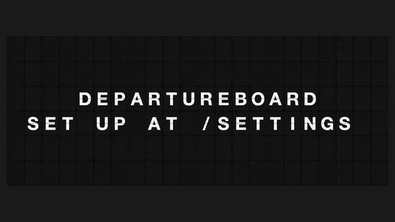

<div align="center">
  <h1>DepartureBoard</h1>
  <p><b>An open-source split-flap departure board for any TV. One command, one board.</b></p>
  
  <p><sub>The Compact preset (6 × 22) running the built-in demo — <code>http://&lt;host&gt;:8080/?demo</code></sub></p>
</div>

---

The real split-flap boards start above $2,000. Most people who want one want the look, the
clicks and the ritual of a message flipping into place — and a TV on the wall is already paid
for. DepartureBoard gives you that: a browser page that behaves like the board, and a settings
page to put messages on it and schedule them.

## Quick start

```bash
git clone https://github.com/cmldexter/DepartureBoard.git
cd DepartureBoard
docker compose up --build
```

Then:

- On the TV, open `http://<this machine>:8080` and go fullscreen.
- On your laptop, open `http://<this machine>:8080/settings`. The token it asks for was printed
  in the server log on first boot. To get it again without reading logs:

  ```bash
  docker compose exec departureboard cat /data/api_token            # the container
  pbcopy < data/api_token                                            # a `uv run` dev server, macOS: straight to the clipboard
  xclip -selection clipboard < data/api_token                        # Linux
  ```

Optional: copy `.env.example` to `.env` to change the port, set your timezone, or bring your own token.

## What you get

- **The board** (`/`) — two display presets, **Compact** (6 × 22, for a 42–48" TV) and
  **Large** (8 × 28, for 55–77"), the flip animation and the click, a slider from "instant" to
  the full mechanical pace, mute, a handful of themes (frame, background, type), and a
  fullscreen button that keeps the TV awake.
- **The settings page** (`/settings`) — write messages, schedule them (a window, a daily or
  weekly repeat), choose the preset, theme, animation and sound.
- **The API** — everything the settings page does. Swagger at `/docs`.
- **The integrate page** (`/integrate`) — copy-paste `curl` lines pre-filled with your own host
  and token, so your calendar, your home automation or your agent can post to the board tonight.

> Status: the project is being built in the open and the loop is closed — a message written on
> the settings page (or posted with one curl) flips onto the TV, with sound, four themes, a
> fullscreen button that keeps the TV awake, schedules, colour chips, emoji and your own
> pictures. What remains before `v0.1.0`: the published container image and the TV setup guide. Follow the [milestones](https://github.com/cmldexter/DepartureBoard/milestones).

## Bring your own integration

We will not add a calendar panel, a chat bot or a weather widget to the UI. The board has an
API, and we ship three things so that your own agent, script or automation can drive it:

1. **The integrate page** — `http://<this machine>:8080/integrate`, behind the same token as
   settings: copy-paste `curl` lines pre-filled with your host and your token, one per task
   (post now, a window, daily, weekly, a picture, list, delete, the display), with the expected
   response under each. The complete reference is `/docs` (Swagger, generated from the code).
2. **The shortest call** — `POST /api/messages/now` takes a plain-text body, so a cron line,
   Home Assistant's `rest_command` or an n8n node is one line:

   ```bash
   curl -X POST http://<this machine>:8080/api/messages/now \
     -H "Authorization: Bearer $TOKEN" -H "Content-Type: text/plain" --data 'DINNER AT 7'
   ```
3. **The agent bundle** under [`integrations/`](integrations/): runnable `curl` examples, an
   **Agent Skill** (`SKILL.md`, the format Claude Code, Hermes Agent and others read) and
   `llms.txt` (also served at `/llms.txt`).

That keeps the app small and keeps your integrations yours. CORS is off; set
`DEPARTUREBOARD_CORS_ORIGINS` to a comma-separated list of origins if a browser app elsewhere
must call the API. Share what you build in
[Discussions → Show and tell](https://github.com/cmldexter/DepartureBoard/discussions/categories/show-and-tell).

## Requests and bugs

Issues are open. Feature requests are welcome **within reason**: the board stays two pages,
needs no configuration to run, and starts from one command. Bigger ideas start as a discussion.
See [CONTRIBUTING.md](CONTRIBUTING.md).

## Origin

This exists because [**@feltbykraft**](https://www.instagram.com/feltbykraft/) asked for it in a
thread about the real boards — *"come find me when that exists."* It exists.

## License

[GPL-3.0](LICENSE).
