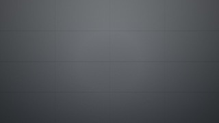
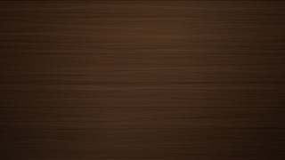
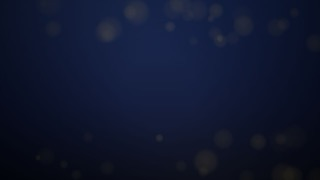
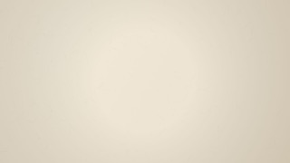
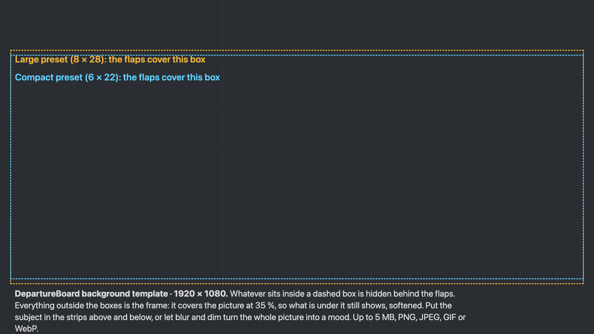

# Behind the board, and the frame around it

The board can sit on a picture: a poster from your phone, blurred into a mood for a party, or
one of the four that ship with the app for a quieter look. It can sit on a **video** of your own,
playing muted in a loop. The flaps keep their theme; a matte frame turns translucent over the
picture; the board stays readable. And the **frame** itself — the bezel around the board — has
its colour, width, corners and finish in your hands.

## The four-click version

1. Snip the poster on your phone or laptop (a screenshot is fine) and send it to the computer
   with the settings page.
2. **Settings → Look & feel → Behind the board → Upload…** and pick the file. It appears as a
   swatch and is selected.
3. Drag **Blur** until the picture is a mood rather than a poster — 12 px is the default, 20–30
   hides the words — and **Dim** until the flaps read; the live card follows every move.
4. **Save background.** The TV picks it up on its next poll.

The gaps between the flaps show the **board's colour**, not the picture — the picture lives under
the frame. A picture *on* the flaps (`{img:slug@9x1}` in a message) is a different thing: for that
one, **Look & feel → The flaps → Picture mode** tightens the corners, the gap and the split line so
less of it is lost to the grid.

**Clear** takes the picture away and keeps your blur and dim for next time. The same four settings
are on the API — `PATCH /api/settings` with `background_image`, `background_blur`,
`background_dim` and `background_fit` — so a script can set the party look and take it down.

## The ones that ship

| `builtin:terminal` | `builtin:wood` |
|---|---|
|  concrete grey, a departures hall |  dark walnut planks |
| **`builtin:gala`** | **`builtin:paper`** |
|  deep navy with gold bokeh — the formal one |  warm off-white, made for Arctic White |

They are drawn by the project, 1920 × 1080, 20–110 KB each, under `app/static/backgrounds/`.

## Making your own

- **Size.** 1920 × 1080 (16:9) fills a TV with nothing cropped. Any size works: **fill** (the
  default) scales the picture to cover the screen and crops the overflow; **fit** shows all of it
  and leaves the theme's colour around the edges.
- **The safe area.** The flaps cover a box in the middle; whatever is under them is hidden. The
  template below has that box drawn for both presets. What shows is the strips above and below
  the board and a narrow band at the sides, all at 35 % frame colour, so a subject placed in the
  top strip reads and anything under the flaps does not matter.
- **Blur and dim.** Blur (0–40 px) softens; dim (0–90 %) darkens. A busy photo wants both; a
  flat texture wants neither. The defaults are 12 px and 30 %.
- **The upload limit is 5 MB.** A phone screenshot is 1–3 MB; a camera photo may need resizing.
  PNG, JPEG, GIF or WebP.
- **The cost.** The TV loads the picture once per page load and caches it, so a big file costs
  the first paint and nothing after. Blur is rendered by the browser on the TV; a Raspberry Pi
  handles 40 px at 1080p, a Fire TV Stick is happier below 20.



`docs/background-template.png` is that template at full size — open it in any editor, put your
picture on a layer beneath, and keep the subject outside the dashed boxes.

## A video behind the board

**Settings → Look & feel → Behind the board → Upload a video…** takes an MP4 or WebM up to
250 MB. It appears as a tile with its first frame and is selected; the live card plays it; **Save
background** sends it to the TV, where it plays muted, in a loop, under the frame. **Dim** works
over it as over a picture; **Fit** is *fill the screen* or *fit inside*; the × on the tile deletes
the file (a video that is on the TV comes off it as it goes).

- **Blur starts at 0 for a video.** Picking a video sets the Blur slider to 0; you can raise it,
  but a blur filter over a moving 1080p picture is the one thing a TV stick cannot afford. Keep it
  at 0 on a Fire TV Stick or a Chromecast; a Raspberry Pi 4 or a laptop manages some.
- **The file is stored as it is** — the server never re-encodes. What plays on the weakest TV
  browser is **1080p h264, no sound, fast start**. From any clip, one line:

  ```sh
  ffmpeg -i in.mp4 -vf scale=1920:-2 -an -c:v libx264 -crf 23 -movflags +faststart out.mp4
  ```

  A three-minute 1440p phone clip of 150 MB comes out around 60 MB at 1080p; `-crf 28` halves
  that again at a small cost in detail. `-an` drops the sound the TV never plays; `+faststart`
  puts the index first so the TV starts before the whole file is down.
- **The loop seam.** A clip that ends where it starts (a slow pan that returns, a loop made for
  it) loops without a cut; anything else jumps once per lap. The length does not matter.
- **Reduced motion.** A TV or browser set to reduce motion shows the video's first frame and
  nothing moves — a still, like a picture.
- **The cost.** The TV decodes the video for as long as the board is up. Every TV browser decodes
  1080p h264 in hardware; 4K or VP9 depends on the device. Pictures stay the cheaper choice for a
  board that is up all day on a stick.
- **On the API:** `POST /api/videos` (multipart `file`, optional `slug`), `GET /api/videos`,
  `DELETE /api/videos/{slug}`; the TV plays `GET /videos/{slug}`, which answers Range requests.
  `PATCH /api/settings` with `{"background_image": "video:<slug>", "background_blur": 0}` puts
  it behind the board.

## The frame

The bezel around the board is each theme's own: Classic Black's dark grey, Walnut's wood, GSX
Terminal's black chrome with a cyan edge. **Settings → Look & feel → The frame** overrides it, one
setting at a time, and *As the theme* gives any of them back:

| Setting | On the API | What it does |
|---|---|---|
| **Fit** | `frame_fit` `screen` · `board` | *Fills the screen* is the classic slab; *Hugs the flaps* wraps the bezel around the board so the page — or the video — shows all around it |
| **Size** | `board_scale` 25–100 | The board's size as a share of the screen; 85 leaves a band of the backdrop around a hugging board |
| **Margin** | `board_margin` 0–10 | The board's own colour between the bezel and the flaps, in vmin; it also absorbs a round corner |
| **Colour** | `frame_color` `"#rrggbb"` or `""` | The bezel's colour |
| **Width** | `frame_width` 0–10 or `""` | In vmin (hundredths of the screen's shorter side); the themes use 3, Walnut 4 |
| **Corners** | `frame_radius` 0–30 or `""` | The outer corner radius in vmin; the page or the backdrop shows in the rounded corners |
| **Finish** | `frame_finish` `theme` · `matte` · `chrome` · `neon` | *Matte* is the flat colour; *chrome* a metallic bezel the board tucks under; *neon* a glowing edge |
| **Glow** | `frame_glow` `"#rrggbb"` or `""` | The neon edge's colour (shown for neon) |

**A rounder corner needs a wider bezel or a margin.** The corners never cut into a flap: the
radius is capped at about 3.4 × (width + margin), so a thin 2 vmin chrome bezel with a 2 vmin
margin still takes a 13 vmin corner; for a pill-shaped board raise the margin first — it is the
board's own colour, not chrome, and the board's own inner corner only rounds as far as the margin
allows (the bezel thickens at the corners, as a screen's does). The slider's readout says *capped
by the width + margin* when it is.

**Chrome** is drawn as a bezel with a rounded profile lit from above: a bright rim on the outer
edge, light on top of the curve, shadow under it, and a shadow onto the page. The board **hides
under it**: a dark groove where the chrome curls down, and the bezel's shadow falling onto the
panel's edge, flaps included, so the board reads as recessed rather than laid beside the bezel.
Every part scales with the width, so a thin bezel reads as a thin tube and a wide one as a slab.

**The flaps' depth** goes with it: **Look & feel → The flaps → Depth** (`cell_depth` 0–100, `""` =
as the theme) lights the top half of every flap, shadows the bottom half under the leaf's lip and
drops a soft shadow under each flap. The four classic themes are flat until you raise it; GSX
Terminal carries 45 of its own. *Picture mode* sets it to 0 so a banner across the flaps stays
clean.

**Over a picture or video**, a matte frame (and the four classic themes' own) is 35 % see-through
as before; a **chrome or neon** frame stays solid — the bezel reads as an object sitting over the
moving picture. *Black chrome* is one button: hugs the flaps at 85 %, a 2 vmin margin, `#050308`,
width 2, corners 6, chrome.

The five settings travel with a saved board (a profile) like the rest of the look.

## Where the pictures live

An uploaded background is an ordinary picture in the Images panel: it has a token and can be put
in a message like any other. Deleting it there removes the background too; the board falls back
to the theme's colour.
